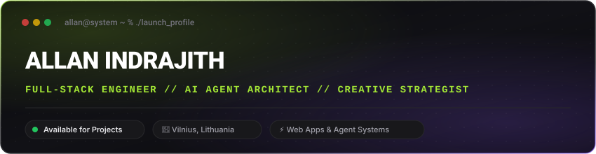

<p align="center">
  
</p>

<p align="left">
  <a href="https://itsallan.me/">
    
  </a>
</p>

---

### 🚀 About Me

I engineer high-performance web applications, interactive digital interfaces, and autonomous agent workflows. My work focuses on the intersection of deep engineering and intentional design—turning complex system architecture into seamless, visually captivating experiences.

```yaml
profile:
  name: "Allan Indrajith"
  location: "Vilnius, Lithuania 🇱🇹"
  status: "🟢 Available for high-impact projects & technical partnerships"
  current_focus:
    - "Multi-agent systems & AI-driven developer automation"
    - "Modern full-stack web & desktop applications (React, Tauri, Rust)"
    - "Refined UI/UX systems with motion & high craft"
```

---

### 🛠 Tech Arsenal

| Domain | Technologies |
| :--- | :--- |
| **Frontend & UI** |     |
| **Backend & Core** |     |
| **AI & Automation** |    |
| **Design & Tools** |    |

---

### 📈 Activity & Streak

<p align="left">
  
</p>

---

### 🌐 Connect With Me

<p align="left">
  <a href="https://itsallan.me/">
    
  </a>
  <a href="https://www.linkedin.com/in/ksallanindrajith">
    
  </a>
  <a href="https://www.instagram.com/ksallanindrajith">
    
  </a>
</p>
