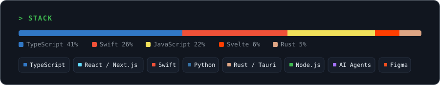

  

The window shows the weather in Lithuania right now. The monitor scrolls my latest commits; the shelf holds a book for each language I write.

  <a href="https://github.com/allanindrajith">GitHub</a> &nbsp;·&nbsp; <a href="https://itsallan.me/">Website</a> &nbsp;·&nbsp; <a href="https://www.linkedin.com/in/ksallanindrajith">LinkedIn</a>

  

  

  

